# The Thomson problem for 11 points

This repository contains a Lean 4 formalization of the solution of the Thomson problem for
$N=11$ points on the sphere $S^2$. The main theorem says that the Coulomb energy has a minimizer,
that the minimizer is unique up to orthogonal transformations and relabelling of the points, and
where it lies: its coordinates are given up to $10^{-10}$.



## Preliminaries

For a configuration $Y=(y_1,\ldots,y_{11})$ of distinct points on $S^2$ let

```math
E(Y)=\sum_{1\le i\lt j\le 11}\frac{1}{\lVert y_i-y_j\rVert}.
```

Let $X_0$ be the following table of eleven points of $\mathbb{R}^3$, one point in each row:

```math
X_0=\left(\begin{array}{rrr}
0.313620689025589 & 0.319317483958265 & 0.894247397454238\\
0.122131934022939 & -0.879707882375786 & 0.459562653375714\\
0.836384234608648 & 0.540732019932700 & 0.089834819071496\\
-0.829513636587083 & -0.542301295299786 & -0.133478207330809\\
-0.566960498580477 & 0.239819275605855 & -0.788062502659060\\
0.061432238616290 & -0.754530255111397 & -0.653383634766071\\
-0.016529763516812 & 0.987228274258469 & -0.158452205483935\\
0.892049358244038 & -0.450479658797258 & 0.036276982596482\\
0.482848954144595 & 0.189339586942292 & -0.854989712393075\\
-0.513162273240149 & -0.211638860342633 & 0.831789320751279\\
-0.786447187737911 & 0.558000050679941 & 0.264833465295296
\end{array}\right)
```

## Formalized theorem

**Theorem.** There exists a configuration $X$ of 11 distinct points on $S^2$ such that the
following holds:

1. Every configuration $Y$ of 11 distinct points on $S^2$ satisfies $E(Y)\ge E(X)$, with equality
   if and only if $Y$ arises from $X$ by an orthogonal transformation and a relabelling of the
   points.
2. Every coordinate of every point of $X$ differs from the corresponding entry of $X_0$ by at
   most $10^{-10}$.
3. The minimal energy satisfies $40.59644951\lt E(X)\le 40.59645051$.

`thomson_11_points` is the Lean formulation of this theorem. The following declaration is from
[Showcase.lean](Showcase.lean), which contains all definitions that the statement uses and imports
only Mathlib.

```lean
theorem thomson_11_points :
    ∃ X : Fin 11 → Point,
      IsUniqueMinimizer X ∧
      (∀ i k, |X i k - X₀ i k| ≤ 1 / 10 ^ 10) ∧
      40.59644951 < E X ∧ E X ≤ 40.59645051
```

<table><tr><td>

**Dependencies:** The proof of `thomson_11_points` in
[Showcase_WithProofs.lean](Showcase_WithProofs.lean) compiles and depends only on `propext`,
`Classical.choice` and `Quot.sound`, Lean's three standard axioms. It uses neither
`native_decide` nor `sorry`.

</td></tr></table>

## Lean entry points

- [Showcase.lean](Showcase.lean): the definitions and the statement of the theorem, with `sorry`
  in place of the proof. Mathlib is its only import.
- [Showcase_WithProofs.lean](Showcase_WithProofs.lean): the same definitions and the same
  statement with the complete proof, followed by a test of its axioms.
- [LeanCode/N11/Statement.lean](LeanCode/N11/Statement.lean): the theorem in the coordinates of
  the proof, `N11.Thomson11`.
- [Certificates/Route/N11RG.lean](Certificates/Route/N11RG.lean) and
  [Certificates/G7_LocalConstants/N11L_G7.lean](Certificates/G7_LocalConstants/N11L_G7.lean): the
  statements that the proof takes from its certificates, `N11RG.routeG` and `N11L.g7`.
- [Certificates/Theorem/T6A.lean](Certificates/Theorem/T6A.lean): the theorem
  `N11.T6A.thomson11 : N11.Thomson11`.
- [LeanCode/N11/Analytic/Main.lean](LeanCode/N11/Analytic/Main.lean): the analytic part,
  `N11.thomson11_of`.
- [comparator.json](comparator.json): Comparator configuration for the theorem and its
  definitions in the two showcase files.

## Repository layout

| Path | Contents |
| --- | --- |
| [Showcase.lean](Showcase.lean) | The statement of the main theorem, self-contained on the basis of Mathlib. |
| [Showcase_WithProofs.lean](Showcase_WithProofs.lean) | The same statement with its proof. |
| [Certificates](Certificates) | The numerical certificates: 5,914 Lean modules with exact data, the kernel checks and the statements that follow from them. The 5,767 modules with data are stored compressed. |
| [AnalyticArguments](AnalyticArguments) | The proof in the form that Lean verifies (TeX and PDF): the theorem, the statements that Lean takes from the certificates, and the analytic arguments. |
| [LeanCode](LeanCode) | The Lean code of the verification: statement, checkers, soundness theorems, analytic part. |
| [Visualization](Visualization) | The animation above, an SVG file of 88 kB, and the program that writes it. |
| [lakefile.toml](lakefile.toml), [lake-manifest.json](lake-manifest.json), [lean-toolchain](lean-toolchain) | The Lake project. They pin Lean 4.33.0 and the revision of Mathlib. |

## Building

The project uses Lean 4.33.0. The dependencies are pinned in
[lake-manifest.json](lake-manifest.json). To unpack the certificates and to compile the library,
the certificates and both showcase files, run

```sh
python3 Certificates/unpack.py
lake exe cache get
LEAN_NUM_THREADS=8 lake build
```

`Showcase.lean` produces one expected `sorry` warning. `Certificates/unpack.py` unpacks the
compressed modules of the certificates and compares all modules with the SHA-256 values of
[Certificates/MANIFEST.sha256](Certificates/MANIFEST.sha256); it needs Python 3 only.
`LEAN_NUM_THREADS` is the number of modules compiled at a time. A complete build on Linux
compiles 6,020 modules of this repository on top of Mathlib in 11.4 hours of CPU time, which were
72 minutes with 9 to 14 modules at a time on a server that ran other jobs. It needs up to 3 GB of
memory for each module compiled at a time and 6 GB for the last modules. The unpacked modules need
13 GB of disk space and the `.lake` directory about 17 GB.
